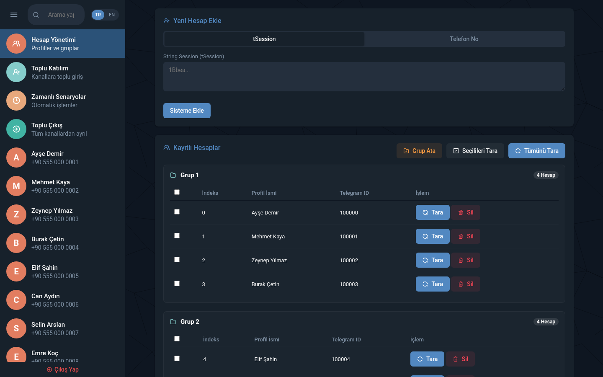
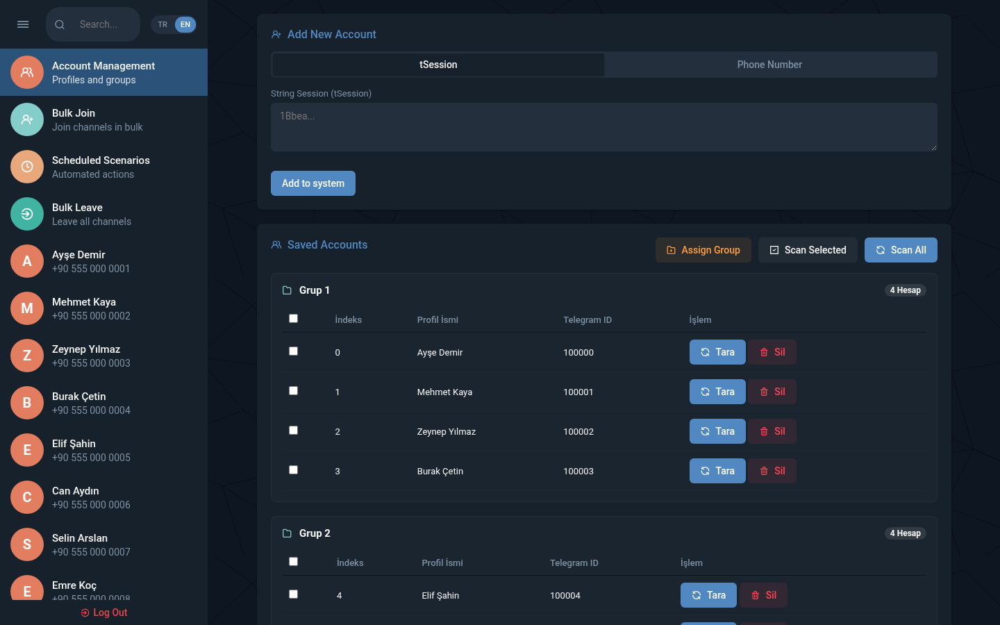
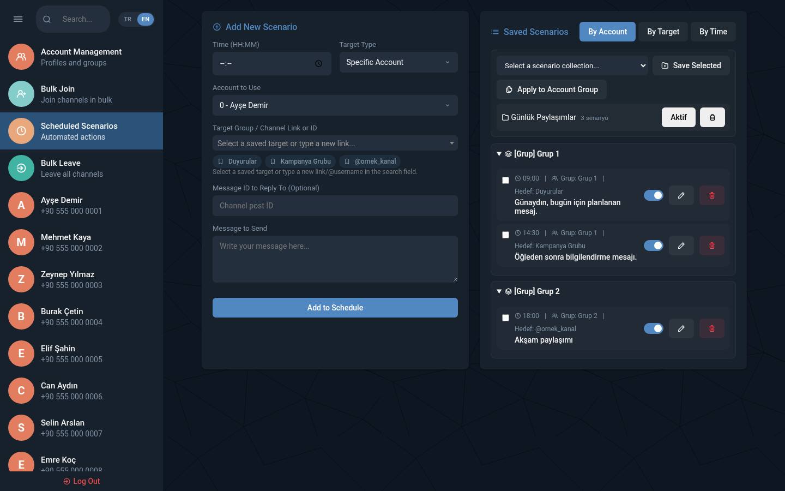

# Telegram Account Manager — Türkçe

Telegram hesaplarını, hesap gruplarını ve zamanlı mesaj senaryolarını tek bir web panelinden yönetmek için hazırlanmış uygulama.

**English documentation:** [README.md](README.md)

## Özellikler

- StringSession veya telefon doğrulamasıyla hesap ekleme
- Hesapları özel gruplara ayırma
- Hesap grubuna göre toplu katılım ve çıkış işlemleri
- Kayıtlı grup/kanal hedeflerini hızlı seçme
- Saat bazlı mesaj ve yorum senaryoları
- Senaryo koleksiyonlarını aktif/pasif yapma ve başka hesap grubuna kopyalama
- Telegram sohbetlerini, klasörlerini, mesajlarını ve medyalarını panelden görüntüleme
- Kaydırılabilir hesap listesi ve daraltılabilir senaryo listeleri
- Türkçe ve English dil seçimi
- Metin StringSession veya metin formatındaki `.session` dosyasını yükleme

> SQLite/Telethon formatındaki `.session` dosyaları doğrudan StringSession değildir ve panel tarafından sessizce dönüştürülmez. Bu dosyaları önce StringSession formatına dönüştürmeniz gerekir.

## Kurulum

```bash
npm install
cp .env.example .env
nano .env
node --env-file=.env bot.js
```

`.env` içeriği:

```env
TELEGRAM_BOT_TOKEN=bot_token
TELEGRAM_ADMIN_ID=telegram_id
ADMIN_PASSWORD=guclu_panel_sifresi
TELEGRAM_API_ID=api_id
TELEGRAM_API_HASH=api_hash
```

## Sunucudaki mevcut hesaplarla Git güncellemesi

Sunucuda Git deposunu hesap/session verilerinden ayrı tutun. `hesaplar.json`, `senaryolar.json`, `senaryo-gruplari.json`, `dialoglar.json`, `apiler.txt`, `proxyler.txt`, `.env` ve `.session` dosyaları Git’e gönderilmez.

Önce uygulamayı durdurun ve veri dosyalarını depo dışına yedekleyin. `reset` takip edilen dosyalardaki yerel kod değişikliklerini siler; önce `git status` çıktısını inceleyin. Ayrı bir uygulama deposunda güncelleme:

```bash
cd /var/www/telegram-manager
git fetch origin
git status --short
git reset --hard origin/master
npm ci --omit=dev
```

Bu veri yolları mevcut depoda takip edilmediğinden reset normalde onları korur. Ancak bu bir yedek garantisi değildir: takip edilen dosyalarla çakışan izlenmeyen yolların üzerine yazılabilir. Veri bulunan klasörde `git clean` kullanmayın. Senaryolar hesap indekslerine bağlı olduğundan `hesaplar.json` içindeki hesap sırasını değiştirmeyin.

İsteğe bağlı olarak verileri depo dışında tutabilirsiniz. Aşağıdaki bağlantıları yalnızca gerçek verileri hedef klasöre taşıyıp yedekledikten sonra, uygulama klasöründe aynı adlı dosyalar yokken oluşturun:

```bash
mkdir -p /var/lib/telegram-manager-data
ln -s /var/lib/telegram-manager-data/hesaplar.json hesaplar.json
ln -s /var/lib/telegram-manager-data/senaryolar.json senaryolar.json
ln -s /var/lib/telegram-manager-data/senaryo-gruplari.json senaryo-gruplari.json
ln -s /var/lib/telegram-manager-data/dialoglar.json dialoglar.json
```

Güncellemeden önce hesabınızı ve senaryo dosyalarınızı mutlaka yedekleyin. Plesk Node.js uygulamasında `.env` değerlerini Environment Variables bölümüne girip uygulamayı yeniden başlatın.

## Ekran görüntüleri

Gerçek hesap/session bilgileri içermeyen maskeli demo ekran görüntüleri:







## Güvenlik

Bot token’ı, API anahtarları, panel şifresi, Telegram ID’leri, telefon numaraları ve session dosyalarını GitHub’a göndermeyin. Daha önce Git geçmişine hassas veri girdiyse yalnızca dosyayı silmek yeterli değildir; geçmişi temizleyip token’ları yenileyin.

## Lisans

Lisans bilgisi daha sonra eklenebilir.
